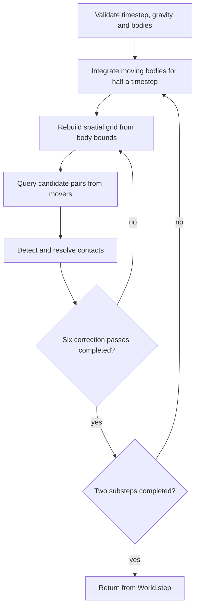

# Headless simulation implementation

These sources form `Kinetra::Simulation` and depend only on the standard library. Their public contracts are declared in [include/kinetra](../../include/kinetra/README.md).

## Table of contents

- [Source map](#source-map)
- [Relationships](#relationships)

[Parent guide](../README.md) · [Project overview](../../README.md) · [Documentation index](../../docs/README.md)

## Source map

| File | Responsibility |
| --- | --- |
| [physics.cpp](physics.cpp) | Body integration, contacts, impulses and world stepping |
| [spatial_grid.cpp](spatial_grid.cpp) | AABB indexing and overlap queries |
| [collision_grid.cpp](collision_grid.cpp) | Occupancy and segment collision queries |
| [navigation.cpp](navigation.cpp) | Path planning and route following |
| [weighted_grid.cpp](weighted_grid.cpp) | Rectangular-cell congestion A* and free-space borders |
| [priority_steering.cpp](priority_steering.cpp) | Prioritized rectangular mover safety and arrival forces |
| [steering.cpp](steering.cpp) | Local steering and obstacle avoidance |

## Relationships

`physics.cpp` rebuilds the broad phase after each correction pass because corrections can create new contacts. Fixed bodies remain indexed but do not initiate queries. See the physics contract for timestep and collision limitations.

Navigation and steering build on geometry and spatial queries without depending on SDL/OpenGL. Applications own world generation and AI policy.

See [math and physics](../../docs/engine/math-physics.md), [navigation](../../docs/engine/navigation.md) and the [test guide](../../tests/README.md). Return to the [source map](../README.md).
