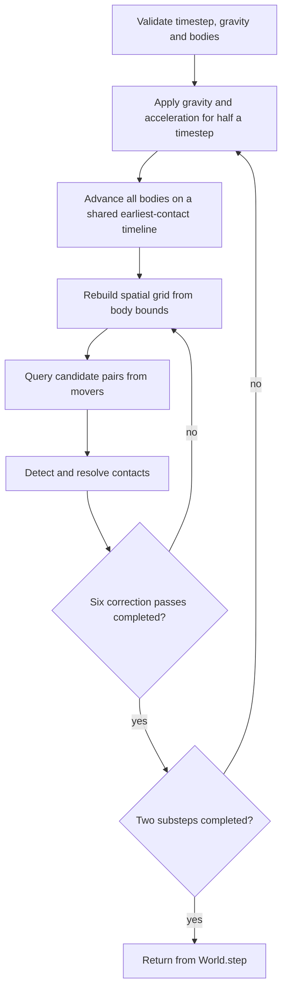

# Headless simulation implementation

These sources form `Kinetra::Simulation` and depend only on the standard library. Their public contracts are declared in [include/kinetra](../../include/kinetra/README.md).

## Table of contents

- [Source map](#source-map)
- [Relationships](#relationships)

[Parent guide](../README.md) · [Project overview](../../README.md) · [Documentation index](../../docs/README.md)

## Source map

| File | Responsibility |
| --- | --- |
| [traffic.cpp](traffic.cpp) | Stable FIFO admission, temporary eligibility, request cancellation and physical occupancy protection |
| [avoidance.cpp](avoidance.cpp) | Reciprocal circular velocity constraints, reachable velocity selection and bounded relaxation |
| [physics.cpp](physics.cpp) | Body integration, circle/OBB/convex polygon contacts, area inertia, relative convex translation sweeps, shared collision timeline, impulses and world stepping |
| [spatial_grid.cpp](spatial_grid.cpp) | AABB indexing and overlap queries |
| [collision_grid.cpp](collision_grid.cpp) | Occupancy and segment collision queries |
| [navigation.cpp](navigation.cpp) | Path planning and route following |
| [weighted_grid.cpp](weighted_grid.cpp) | Footprint-aware congestion A*, swept clearance and merged free-space borders |
| [priority_steering.cpp](priority_steering.cpp) | Prioritized mover steering and bounded wall-normal velocity constraints |
| [steering.cpp](steering.cpp) | Local steering and obstacle avoidance |

## Relationships

`physics.cpp` rebuilds the broad phase after each correction pass because corrections can create new contacts. Fixed bodies remain indexed but do not initiate queries. See the physics contract for timestep and collision limitations.

`avoidance.cpp` constructs circular or fixed axis-aligned rectangular velocity
obstacles and selects velocities subject to speed and acceleration limits. Mixed
shape pairs use enclosing circles; see the navigation contract for feasibility limits.

Navigation and steering build on geometry and spatial queries without depending on SDL/OpenGL. Applications own world generation and AI policy.

See [math and physics](../../docs/engine/math-physics.md), [navigation](../../docs/engine/navigation.md) and the [test guide](../../tests/README.md). Return to the [source map](../README.md).
