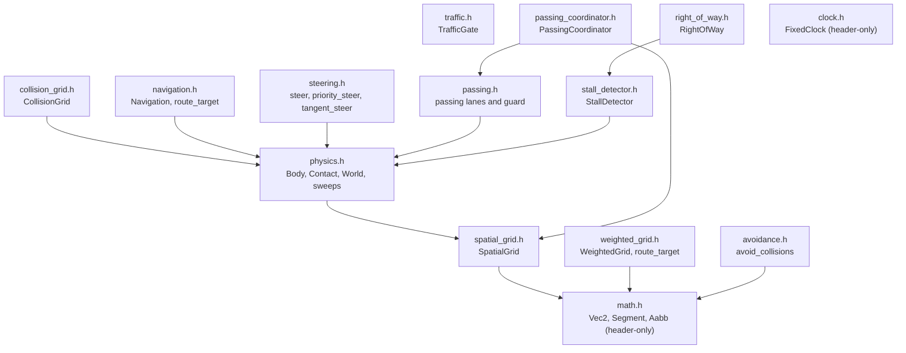
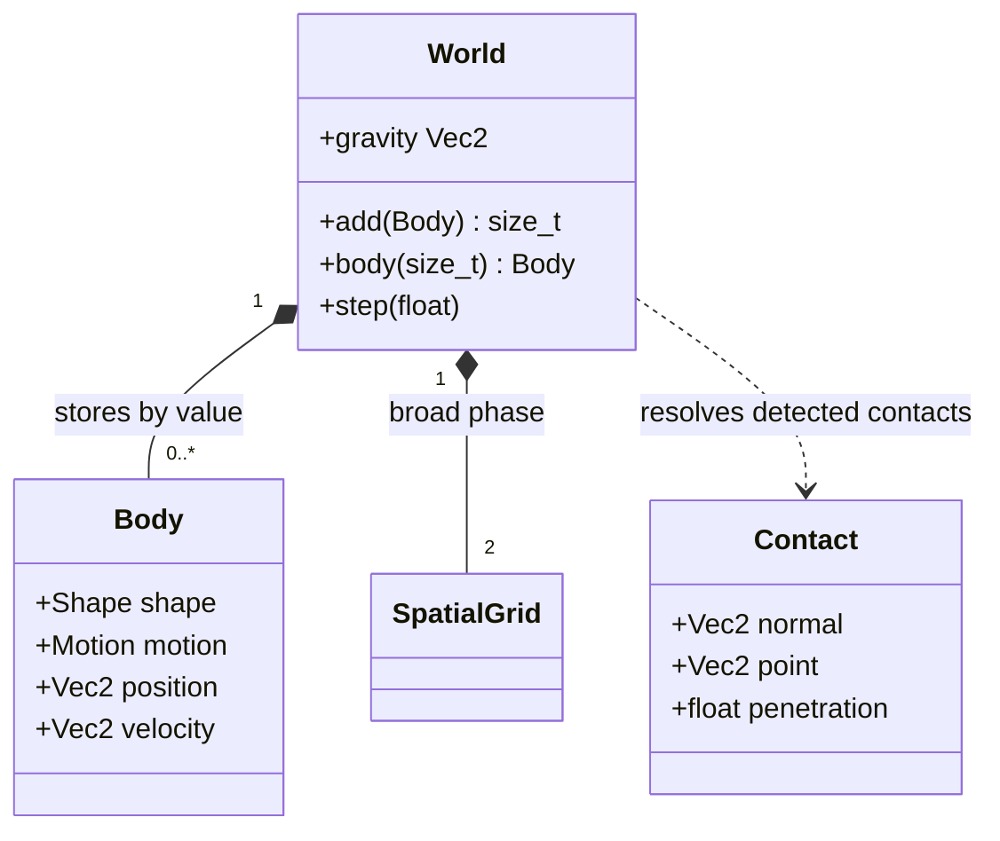

# Simulation

The headless half of Kinetra (`Kinetra::Simulation`): geometry, rigid-body physics, spatial queries, path planning, steering, local avoidance and traffic admission. Applications such as those in Kinetra-Lab link it to move bodies and agents without any window, so their rules can be tested in plain unit tests.

## Table of contents

- [Purpose and scope](#purpose-and-scope)
- [Concepts](#concepts)
- [Structure](#structure)
- [How it works](#how-it-works)
- [Invariants and contracts](#invariants-and-contracts)
- [Changing this module](#changing-this-module)
- [Tests](#tests)
- [Open points](#open-points)

[Project overview](../../README.md) · [Documentation index](../../docs/README.md)

## Purpose and scope

The module supplies reusable motion mechanisms: what happens when bodies touch, how an agent finds a route around obstacles, how it steers along that route, how two agents pass each other, who may enter a shared zone first, and how elapsed time becomes fixed simulation ticks. It depends only on the C++ standard library.

Not here: drawing, input and windows ([runtime](../runtime/README.md); Simulation does not link it), and every application policy: world generation, goal selection, retry and replanning schedules, update rates, AI decisions and units conversion. Those belong to the consumer, as the [responsibility map](../../docs/architecture.md#responsibility-map) lists.

## Concepts

| Term | Meaning |
| --- | --- |
| World units | The length unit of positions and sizes. The engine never fixes it; i4sim, for example, works in millimeters |
| Seconds, or caller time units | Physics uses seconds. `avoid_collisions`, `PrioritySteering` and `tangent_steer` take any time unit the caller uses consistently, such as simulation ticks |
| World space | Y points up; positive angles rotate counterclockwise, in radians |
| Body | A rigid shape (`circle`, `box` or convex `polygon`) with a motion mode (`fixed`, `controlled`, `dynamic`); a value type |
| Contact | Normal (from the first body toward the second), point and penetration of two touching bodies |
| Sweep | The earliest fraction of a straight movement at which two shapes touch, used to stop fast bodies tunnelling |
| Broad phase | `SpatialGrid`: cheap bounding-box overlap that limits which pairs get an exact contact test |
| Clearance envelope | A circle (`Navigation`) or rectangle (`WeightedGrid`) swept along a path segment; touching a wall is blocked or allowed per planner |
| Acceleration result | Steering functions return an acceleration; the caller integrates it. None of them moves a body |
| Conflict zone | An application-defined area that one agent at a time may enter; `TrafficGate` decides who |

## Structure



*Takeaway:* physics, planning and steering build on one geometry header; the weighted grid, avoidance, traffic admission and the fixed clock stand alone, so a consumer can use one without the others.

| Public header | Source | Responsibility | Contract |
| --- | --- | --- | --- |
| [math.h](../../include/kinetra/simulation/math.h) | header-only | Vectors, segments, circles and bounding boxes | [Math and physics](../../docs/engine/math-physics.md) |
| [spatial_grid.h](../../include/kinetra/simulation/spatial_grid.h) | [spatial_grid.cpp](spatial_grid.cpp) | Rebuildable AABB index with sorted, unique query results | [Math and physics](../../docs/engine/math-physics.md#collision-and-queries) |
| [physics.h](../../include/kinetra/simulation/physics.h) | [physics.cpp](physics.cpp) | Body validation, contacts, impulses, integration, sweeps and `World` stepping | [Math and physics](../../docs/engine/math-physics.md) |
| [collision_grid.h](../../include/kinetra/simulation/collision_grid.h) | [collision_grid.cpp](collision_grid.cpp) | Bodies against an occupancy grid; first blocked fraction of a segment | [Math and physics](../../docs/engine/math-physics.md#collision-and-queries) |
| [navigation.h](../../include/kinetra/simulation/navigation.h) | [navigation.cpp](navigation.cpp) | A* over swept circular clearance, string pulling and route following | [Navigation](../../docs/engine/navigation.md#planning-and-following) |
| [weighted_grid.h](../../include/kinetra/simulation/weighted_grid.h) | [weighted_grid.cpp](weighted_grid.cpp) | Congestion-weighted A* with a rectangular footprint; merged free-space borders | [Navigation](../../docs/engine/navigation.md#weighted-grids-and-priority-steering) |
| [steering.h](../../include/kinetra/simulation/steering.h) | [steering.cpp](steering.cpp), [priority_steering.cpp](priority_steering.cpp) | `steer` (arrival and predictive avoidance), `priority_steer` and `constrain_borders` (axis-aligned boxes and walls), `tangent_steer` (experimental) | [Navigation](../../docs/engine/navigation.md#contracts) |
| [avoidance.h](../../include/kinetra/simulation/avoidance.h) | [avoidance.cpp](avoidance.cpp) | ORCA-style velocity selection under speed and acceleration limits | [Navigation](../../docs/engine/navigation.md#reciprocal-local-avoidance) |
| [passing.h](../../include/kinetra/simulation/passing.h) | [passing.cpp](passing.cpp) | Head-on conflict timing, lane candidates and obstruction checks | [Navigation](../../docs/engine/navigation.md#predictive-passing) |
| [passing_coordinator.h](../../include/kinetra/simulation/passing_coordinator.h) | [passing_coordinator.cpp](passing_coordinator.cpp) | Plan lifecycle of head-on passing: formation, waits, outcomes | [Navigation](../../docs/engine/navigation.md#predictive-passing) |
| [stall_detector.h](../../include/kinetra/simulation/stall_detector.h) | [stall_detector.cpp](stall_detector.cpp) | Episodes of sustained lack of progress and the evidence at their onset; the push test and input check the right of way shares | [Navigation](../../docs/engine/navigation.md#stall-detection) |
| [right_of_way.h](../../include/kinetra/simulation/right_of_way.h) | [right_of_way.cpp](right_of_way.cpp) | A temporary right of way for a stalled mover that a neighbor pushes back | [Navigation](../../docs/engine/navigation.md#right-of-way) |
| [traffic.h](../../include/kinetra/simulation/traffic.h) | [traffic.cpp](traffic.cpp) | Occupancy-aware FIFO admission to one conflict zone | [Navigation](../../docs/engine/navigation.md#traffic-admission) |
| [clock.h](../../include/kinetra/simulation/clock.h) | header-only | `FixedClock`: elapsed seconds to whole simulation ticks, with a bounded backlog | [Sessions and timing](../../docs/engine/runtime.md#sessions-and-timing) |

The header summaries (`///`) state each function's units, preconditions and errors; the contract pages explain the behavior in depth.

The `World` owns its bodies by value and indexes them with its own grid:



*Takeaway:* there is no shape hierarchy; `Shape` and `Motion` are enums on one value type, and contacts are results, not objects with identity.

## How it works

**Physics step.** `World::step` splits the step in two substeps. Each substep applies gravity and acceleration, then moves all bodies along one shared timeline: it finds the earliest approaching contact among swept pairs, advances everyone to that moment, resolves the pair's velocities, and repeats until the substep is used up or its event budget runs out. Six discrete correction passes then push apart remaining overlaps, rebuilding the broad phase after each pass because a correction can create a new contact. The broad phase keeps the fixed bodies in an index of their own, rebuilt only when the caller has changed one of them since the last step, and indexes the moving bodies again for every event and pass; a query merges both indexes, so the pairs still come in body-index order, which breaks ties between equal-time events. The [physics update flow](../../docs/engine/math-physics.md#physics-update-flow) draws this, and its *Collision and queries* section explains the tolerances.

*Why a shared timeline:* resolving pairs one by one at their own impact times lets a third body pass through a pair that has not been resolved yet. Advancing everything to the earliest event keeps chains of contacts in order. The cost is the event budget: when bodies bounce more than `8 * moving bodies` times in a substep, the rest of the travel is dropped (`sweep_budget_exhausted()`), which favors containment over exact distance.

**Path planning.** `Navigation::rebuild` rasterizes a bounded area and caches, per grid point, whether the clearance circle fits, which of the eight neighbors are reachable by a swept segment, and which connected region a point belongs to. `path` then runs A* over those cached links and shortens the grid staircase by string pulling, testing every shortcut against the original geometry. Caching once per terrain change is what keeps a crowd of agents planning in one frame cheap; the region labels let an occupied goal snap to the nearest point that is actually reachable. The [planning flow](../../docs/engine/navigation.md#planning-and-following) shows the full decision tree.

**Steering and avoidance.** Planning gives waypoints; local mechanisms turn them into acceleration each step:

| Mechanism | Input | Output | Use when |
| --- | --- | --- | --- |
| `steer` | Any bodies, seconds | Acceleration with arrival and predictive avoidance | General agents following `route_target` |
| `priority_steer` | Axis-aligned boxes and walls, caller time units | Overlap, prediction and seek forces, wall-constrained | Rectangular movers on a grid (i4sim) |
| `avoid_collisions` | Circles and fixed rectangles, caller time units | A velocity and acceleration within limits, plus feasibility | Crowds that must share avoidance reciprocally |
| `tangent_steer` | Any bodies, caller time units | Acceleration from tangent springs | Experiments only; no collision-free guarantee |

The four models overlap and take different inputs; the Lab roadmap schedules a decision on one shared agent-motion interface.

**Traffic admission.** `TrafficGate::update` receives complete snapshots of who requests a zone and who physically occupies it. Occupancy beats the queue: an agent inside the zone blocks new admission even after cancelling. A grant is never revoked, because an approaching agent may no longer be able to stop outside. Geometry, braking and deadlocks between zones stay with the application.

## Invariants and contracts

- **Headless.** No source here includes SDL, OpenGL or a Lab header; the external consumer builds this target without the runtime.
- **Determinism.** No function uses randomness or global mutable state, so equal inputs give equal outputs on one machine. Cross-machine bitwise equality is not promised, but angles do not depend on the C library, except in rare double-rounding cases and under `-ffast-math`: simulation code calls `kinetra::atan2` and `kinetra::asin` from `math.h`, never `std::atan2` or `std::asin` on floats.
- **Validation at the boundary.** Public entry points validate their input and throw `std::invalid_argument` (or `std::out_of_range` for indices), before changing state. `Navigation::rebuild`, for example, checks the area and every obstacle before it replaces its snapshot, so a rejected rebuild leaves the previous one in use. `local_extents`, `bounding_radius` and `bounds` do not validate. The header summaries say which functions throw what.
- **Values, not references.** `World` and `Navigation` copy the bodies they are given. `CollisionGrid` is the one borrowed view: its cell span must outlive the query.
- **Stable indices.** A `World` body keeps its index until `clear()`; there is no removal.
- **Steering never integrates.** Every steering and avoidance function returns an acceleration (and `avoid_collisions` also a velocity); the caller owns the clock and the integration step.

## Changing this module

- **A new shape pair or shape.** Add it to `collide` and the sweep functions in `physics.cpp`, to `validate`, `bounds`, `local_extents` and `bounding_radius`, and to `Navigation::clear_body`. Add cases to `polygon_tests.cpp` and `translation_sweep_tests.cpp`. A new `Shape` value breaks every consumer's switch; record it in an ADR.
- **A tuning constant in the solver** (passes, substeps, slop, budget). Change it in `physics.cpp` with a *why*-comment, update the numbers in the [physics contract](../../docs/engine/math-physics.md), and run `kinetra_moving_contacts`, `kinetra_sweeps` and the 400-body case in `kinetra_behavior`. Lab's Demo tests step a `World`; run Lab's Full level too.
- **A new steering or avoidance option.** Add the field with a default that keeps today's behavior, document its unit on the field, and test both the default and the new value. Changing an existing default changes every consumer that relies on it.
- **Pitfall:** the planners disagree on touching. `Navigation` treats touching the envelope as blocked; `WeightedGrid` allows it. Do not unify them without checking every consumer.

## Tests

| Suite (CTest prefix) | Target | Covers |
| --- | --- | --- |
| `kinetra_behavior` | `kinetra_tests` | Geometry, physics, `steer`, grids, fixed clock, camera, invalid input and a 400-body stability run |
| `kinetra_polygons` | `kinetra_polygon_tests` | Convex validation, contacts, inertia, navigation around polygons |
| `kinetra_sweeps` | `kinetra_sweep_tests` | Circle sweeps: timing, corners, containment, thin walls |
| `kinetra_translation_sweeps` | `kinetra_translation_sweep_tests` | Every convex translation pair |
| `kinetra_moving_contacts` | `kinetra_moving_contact_tests` | Moving/moving contacts, chains, resting gaps, the event-budget fallback |
| `kinetra_navigation` | `kinetra_navigation_tests` | Settings validation, swept clearance, exact and projected goals, corner lookahead |
| `kinetra_weighted_navigation` | `kinetra_weighted_navigation_tests` | Weighted grid planning, raster route targets, footprints, borders and priority steering |
| `kinetra_passing_coordinator` | `kinetra_passing_coordinator_tests` | Passing plans at two world scales: completion, side choice, obstruction, waits, priority between plans, mover states, both timeouts, cancellation and retry delays, footprints of every shape, slow braking, queries beyond the grid |
| `kinetra_right_of_way` | `kinetra_right_of_way_tests` | The right of way at two world scales: grant and window, a new window at once, no grant, early end, the end on a new goal, none for a holder's pusher or for a mover whose pusher holds one, a shorter span in mover order, the shared push test for one mover and every mover; at one scale a window past the clock's end and invalid input |
| `kinetra_stall_detector` | `kinetra_stall_detector_tests` | Stall episodes at two world scales: threshold and end, every reason and its order, restarts, absent movers, invalid input |
| `kinetra_avoidance` | `kinetra_avoidance_tests` | Limits, infeasibility, rectangles and crowds of 2 to 16 agents |
| `kinetra_traffic` | `kinetra_traffic_tests` | FIFO order, eligibility, occupancy and invalid snapshots |

```sh
cmake --workflow --preset headless                     # build and run every simulation suite
ctest --preset dev -R '^kinetra_(navigation|weighted)'  # one area, after cmake --build --preset dev
```

Not covered here: behavior over long application runs and real crowds. Lab's i4sim golden test and Demo crowd tests pin that. The [test guide](../../tests/README.md) has the full map.

## Open points

- Rotating boxes and polygons are swept without rotation, so they can still tunnel ([limits](../../docs/engine/math-physics.md#limits-and-verification)).
- `tangent_steer` is experimental. The caller supplies priority and tangent steering tuning for its distance and time scales.
- The shared footprint of the passing coordinator and the stall detector (`detail/footprint.h`) takes its half extents from `position - bounds.min`, which rounds with the position: in float32 a 0.3 half extent reads 0.297 at x = 100,000. Taking them from the bounds of the body moved to the origin would avoid that, but it changes every passing and stall result by a rounding, so it waits for a change of its own.
