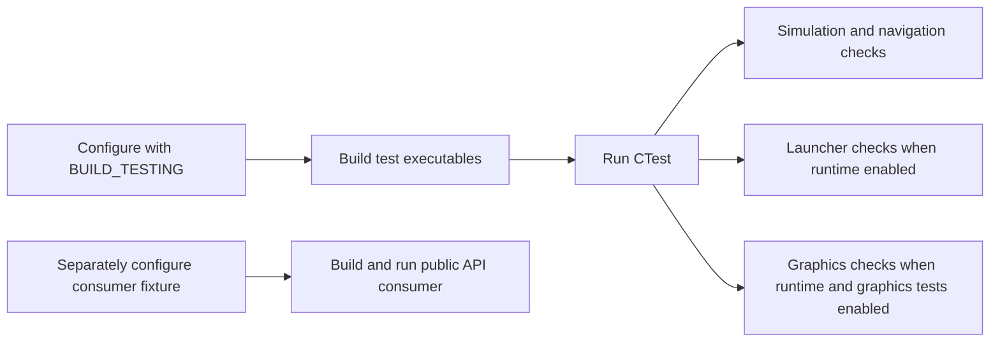

# Core tests

These executables verify reusable engine behavior. Application tests belong to Kinetra-Lab.

## Table of contents

- [Test map](#test-map)
- [Execution](#execution)

[Parent guide](../README.md) · [Documentation index](../docs/README.md)

Directory guides: [consumer](consumer/README.md).

## Test map

| Source or directory | CTest name | Responsibility |
| --- | --- | --- |
| [simulation_tests.cpp](simulation_tests.cpp) | `kinetra_behavior` | Geometry, physics and spatial contracts |
| [navigation_tests.cpp](navigation_tests.cpp) | `kinetra_navigation` | Planning, routes and steering |
| [launcher_tests.cpp](launcher_tests.cpp) | `kinetra_launcher` | Window-free launcher behavior; requires runtime build |
| [runtime_tests.cpp](runtime_tests.cpp) | `kinetra_engine_graphics` | Runtime checks with a real OpenGL context |
| [consumer/](consumer/README.md) | Separate executable | Public headers and CMake source integration |

## Execution

CTest coverage follows the configured options. The separate consumer checks source integration; graphics tests require an actual OpenGL context.

The root [CMakeLists.txt](../CMakeLists.txt) registers tests when `BUILD_TESTING` is enabled. Graphics tests also require `KINETRA_BUILD_RUNTIME` and `KINETRA_TEST_GRAPHICS`. The consumer is configured separately.

See [development](../docs/development.md) for commands, dependencies and graphics backend requirements; see the [implementation map](../src/README.md) for tested modules.

`kinetra_weighted_navigation` covers weighted detours, blocked diagonal corners, invalid cost rollback, arrival braking, safety priority, acceleration limits and coincident bodies.
