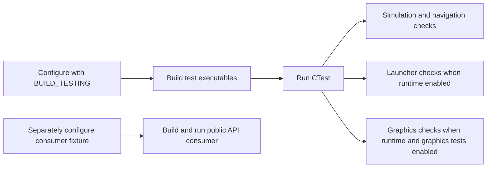

# Core tests

These executables verify reusable engine behavior. Application tests belong to Kinetra-Lab.

## Table of contents

- [Test map](#test-map)
- [Execution](#execution)

[Parent guide](../README.md) · [Documentation index](../docs/README.md)

Directory guides: [consumer](consumer/README.md).

## Test map

| Source or directory | CTest name | Responsibility |
| --- | --- | --- |
| [traffic_tests.cpp](traffic_tests.cpp) | `kinetra_traffic` | FIFO ordering, new arrivals, cancellation, occupied/contested zones, invalid snapshots and reset |
| [avoidance_tests.cpp](avoidance_tests.cpp) | `kinetra_avoidance` | Acceleration/speed limits, infeasibility, deterministic IDs, time units, noncooperative motion, rectangular gap/cutoff/tangent checks, 2/4/8 rectangular encounters and 2/4/8/16 circular-agent arrival without overlap |
| [moving_contact_tests.cpp](moving_contact_tests.cpp) | `kinetra_moving_contacts` | Relative queries, fast moving pairs, crossing/overtaking, chronological chains, spinning tangent-contact progress, narrow resting gaps, tiny-body contact tolerance and observable event-budget fallback |
| [translation_sweep_tests.cpp](translation_sweep_tests.cpp) | `kinetra_translation_sweeps` | All convex translation pairs, timing, orientation, misses, thin walls, repeated impacts and free rotational integration |
| [sweep_tests.cpp](sweep_tests.cpp) | `kinetra_sweeps` | Circle sweep timing, corners, containment, rotated geometry, thin-wall impacts, remaining travel and bounded repeated bounces |
| [polygon_tests.cpp](polygon_tests.cpp) | `kinetra_polygons` | Convex shape validation, exact contacts, transformed geometry, inertia, navigation and falling-body settling |
| [simulation_tests.cpp](simulation_tests.cpp) | `kinetra_behavior` | Geometry, physics, rectangular steering clearance and spatial contracts |
| [navigation_tests.cpp](navigation_tests.cpp) | `kinetra_navigation` | Planning, routes and steering |
| [launcher_tests.cpp](launcher_tests.cpp) | `kinetra_launcher` | Window-free launcher behavior; requires runtime build |
| [runtime_tests.cpp](runtime_tests.cpp) | `kinetra_engine_graphics` | Runtime checks with a real OpenGL context |
| [consumer/](consumer/README.md) | Separate executable | Public headers and CMake source integration |

## Execution

CTest coverage follows the configured options. The separate consumer checks source integration; graphics tests require an actual OpenGL context.

The root [CMakeLists.txt](../CMakeLists.txt) registers tests when `BUILD_TESTING` is enabled. Graphics tests also require `KINETRA_BUILD_RUNTIME` and `KINETRA_TEST_GRAPHICS`. The consumer is configured separately.

See [development](../docs/development.md) for commands, dependencies and graphics backend requirements; see the [implementation map](../src/README.md) for tested modules.

`kinetra_weighted_navigation` covers weighted detours, blocked diagonal corners, invalid cost rollback, arrival braking, safety priority, acceleration limits and coincident bodies. It also covers swept rectangular grid clearance, merged wall segments, continuous bounded reactions at contact, tangential steering, close-wall convergence and discrete braking without wall penetration.
