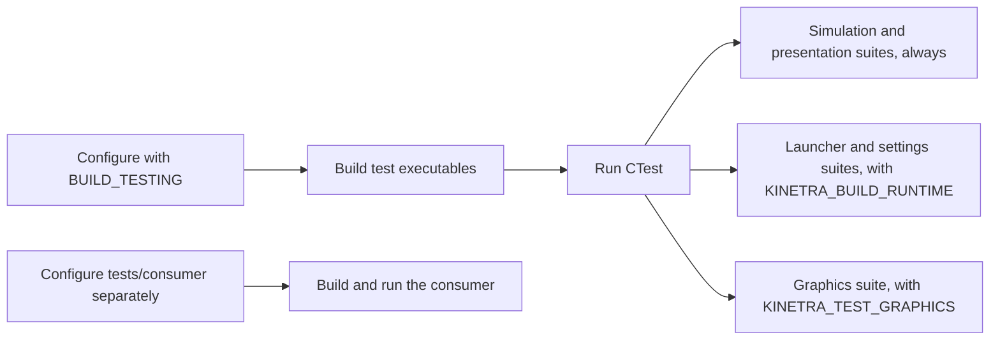

# Core tests

The executables here verify Kinetra's reusable behavior: every engine suite, and a separate consumer project that proves the public headers and targets work from outside the repository. Application tests belong to Kinetra-Lab.

## Table of contents

- [Test map](#test-map)
- [Execution](#execution)
- [External consumer](#external-consumer)
- [Adding a suite](#adding-a-suite)

[Project overview](../README.md) · [Documentation index](../docs/README.md)

## Test map

Every suite is a doctest executable. CTest names each case `<prefix>:<case>`, so `ctest -R '^<prefix>'` selects a suite; build with the target name.

| Source | Target | CTest prefix | Responsibility |
| --- | --- | --- | --- |
| [traffic_tests.cpp](traffic_tests.cpp) | `kinetra_traffic_tests` | `kinetra_traffic` | FIFO ordering, eligibility/ticket preservation, non-revoking grants, new arrivals, cancellation, occupied/contested zones, invalid snapshots and reset |
| [avoidance_tests.cpp](avoidance_tests.cpp) | `kinetra_avoidance_tests` | `kinetra_avoidance` | Acceleration/speed limits, infeasibility, deterministic IDs, time units, noncooperative motion, rectangular gap/cutoff/tangent checks, 2/4/8 rectangular encounters and 2/4/8/16 circular-agent arrival without overlap |
| [moving_contact_tests.cpp](moving_contact_tests.cpp) | `kinetra_moving_contact_tests` | `kinetra_moving_contacts` | Relative queries, fast moving pairs, crossing/overtaking, chronological chains, spinning tangent-contact progress, narrow resting gaps, tiny-body contact tolerance and observable event-budget fallback |
| [contact_response_tests.cpp](contact_response_tests.cpp) | `kinetra_contact_response_tests` | `kinetra_contact_response` | Contact response of whole bodies: slow and fast elastic head-on contacts at 60 and 120 Hz with momentum and energy conservation, contact geometry under a rigid transform for every shape pair, off-center impacts that conserve linear and angular momentum, thin-wall tunneling of convex bodies, and a body resting on a fixed wall |
| [translation_sweep_tests.cpp](translation_sweep_tests.cpp) | `kinetra_translation_sweep_tests` | `kinetra_translation_sweeps` | All convex translation pairs, timing, orientation, misses, thin walls, repeated impacts and free rotational integration |
| [sweep_tests.cpp](sweep_tests.cpp) | `kinetra_sweep_tests` | `kinetra_sweeps` | Circle sweep timing, corners, containment, rotated geometry, thin-wall impacts, remaining travel and bounded repeated bounces |
| [polygon_tests.cpp](polygon_tests.cpp) | `kinetra_polygon_tests` | `kinetra_polygons` | Convex shape validation, exact contacts, transformed geometry, inertia, navigation and falling-body settling |
| [simulation_tests.cpp](simulation_tests.cpp) | `kinetra_tests` | `kinetra_behavior` | Geometry, physics, steering (including rectangular clearance and separation), spatial and collision grids, fixed clock, camera, invalid input and a 400-body stability run |
| [navigation_tests.cpp](navigation_tests.cpp) | `kinetra_navigation_tests` | `kinetra_navigation` | Settings validation, swept clearance, exact and projected goals, and the math boundaries planning relies on |
| [weighted_navigation_tests.cpp](weighted_navigation_tests.cpp) | `kinetra_weighted_navigation_tests` | `kinetra_weighted_navigation` | Weighted detours, blocked diagonal corners, invalid cost rollback, swept rectangular clearance, merged wall segments; priority steering: arrival braking, safety priority, acceleration limits, coincident bodies, tangential steering, close-wall convergence, braking without wall penetration, sliding past a convex corner, and moving along a wall from rest beside the end of another |
| [passing_coordinator_tests.cpp](passing_coordinator_tests.cpp) | `kinetra_passing_coordinator_tests` | `kinetra_passing_coordinator` | Passing plans through a minimal host, every case but the invalid-input one at two world scales, the second at a translated origin: completion without contact, contact without a plan, the world check between candidate sides, obstruction by a standing mover and the retry delay, waits for crossing traffic with priority and a wait that outlasts the timeout, the priority between an older and a younger plan, participants that turn busy or standing, an absent mover, the progress timeout, parallel plans, cancellation, retry delays dropped by `clear()`, absence and `cancel()`, circle, polygon and rotated-box footprints, slow braking that widens the formation range, a participant far from its lanes and a long exit offset, and invalid input (headings that are not unit length, unknown states) |
| [right_of_way_tests.cpp](right_of_way_tests.cpp) | `kinetra_right_of_way_tests` | `kinetra_right_of_way` | The right-of-way fallback, every case but the invalid-input and clock-end ones at two world scales, the second at a translated origin: the grant at the threshold with its pusher, the whole window and its end, a new window at once for a mover still pushed, no grant below the threshold, without a push, with a standing pusher or for a mover busy, standing or absent, the early end when the mover is no longer observed or a shorter span leaves it out, the ends in mover order, the end on a new goal, no right of way for a holder's pusher, whoever pushes it first, nor for a mover whose pusher holds one, `clear()`, `pushing_neighbor()` against the detector's `pushed_back` and `pushing_neighbors()` against it, a window past the clock's end, and invalid input that changes nothing |
| [stall_detector_tests.cpp](stall_detector_tests.cpp) | `kinetra_stall_detector_tests` | `kinetra_stall_detector` | Stall episodes, every case but the invalid-input one at two world scales, the second at a translated origin: the threshold and the end when progress resumes, a stationary blocker on the leg and what is none (behind, beside, beyond reach), a round blocker through its box, opposing movers without headway and what does not oppose (busy, making headway, crossing), a pushed-back mover with an observed or busy pusher and what is no push, a blocker before a push, oscillation from two reversals, the restarts on a new goal, a count that does not grow and a state change, absent movers and `clear()`, and invalid settings or movers that change nothing |
| [presentation_tests.cpp](presentation_tests.cpp) | `kinetra_presentation_tests` | `kinetra_presentation` | Glyph table, HUD lines and error wrapping, zoom stepping, the rate counter, frame times and angle interpolation; header-only, so headless |
| [launcher_tests.cpp](launcher_tests.cpp) | `kinetra_launcher_tests` | `kinetra_launcher` | Menu paging and configuration, the error panel over the menu, `SessionHost` transitions, debug actions and stepper buttons; window-free, requires the runtime build |
| [settings_view_tests.cpp](settings_view_tests.cpp) | `kinetra_settings_view_tests` | `kinetra_settings_view` | Settings overlay layout, rows, capture and actions; window-free, requires the runtime build |
| [runtime_tests.cpp](runtime_tests.cpp) | `kinetra_engine_runtime_tests` | `kinetra_engine_graphics` (label `graphics`) | Input, rendering and resize with a real OpenGL context, frame timing and the frame-time graph, the drawn error panel and HUD error, and the `run_session` and `run_launcher` request and binding rules |
| [consumer/](consumer/) | `consumer` (separate project) | none | Public headers and CMake source integration; see [External consumer](#external-consumer) |

## Execution

*Takeaway:* which suites exist depends on the configure options; the consumer is never part of CTest.

The root [CMakeLists.txt](../CMakeLists.txt) registers the suites when `BUILD_TESTING` is on, each with `kinetra_add_doctest` (one CTest entry per case, label `unit` plus any `LABELS`). The graphics suite needs an OpenGL context; the `graphics` preset provides a software one. Commands and presets are in [development](../docs/development.md); which suites a change needs is in [testing](../docs/testing.md#choosing-targeted-tests).

## External consumer

[consumer/](consumer/) is a standalone CMake project that adds Kinetra from `KINETRA_SOURCE` with `add_subdirectory`, turns Kinetra's own tests off, and links only the public targets. It proves that an application outside the repository can build against `include/kinetra/` and the `Kinetra::` targets.

- [CMakeLists.txt](consumer/CMakeLists.txt) links `Kinetra::Simulation`; with `CONSUMER_GRAPHICS=ON` it also enables the runtime and links `Kinetra::Runtime` and `Kinetra::Launcher`.
- [main.cpp](consumer/main.cpp) exercises geometry, navigation, avoidance and both traffic admission overloads; with graphics it also compiles and links the runtime and launcher interfaces. It never opens a window, so it does not replace the graphics suite.

CI runs it on every pull request that changes more than documentation. Run it yourself when you change a public header, a target or a link dependency; the commands are in [external consumers](../docs/development.md#external-consumers).

## Adding a suite

1. Write the cases in `tests/<topic>_tests.cpp` with doctest; [traffic_tests.cpp](traffic_tests.cpp) is the reference and [writing a doctest suite](../docs/testing.md#writing-a-doctest-suite) explains the rules.
2. Register it in the root `CMakeLists.txt` with `kinetra_add_doctest(<target> PREFIX <prefix> SOURCES tests/<topic>_tests.cpp LIBRARIES <Kinetra target>)`, inside the block that matches the build it needs.
3. Add a row to the [test map](#test-map) and, when it covers a new area, to the targeted-tests table in [testing](../docs/testing.md#choosing-targeted-tests).
