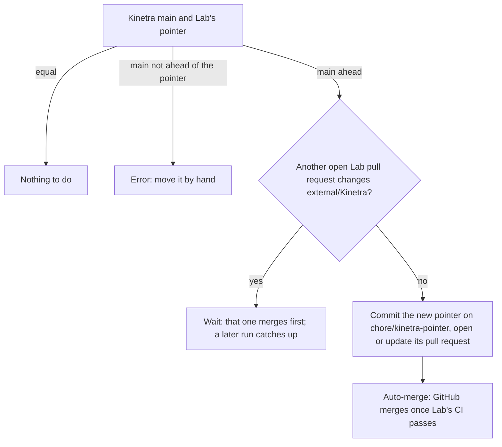

# Tools

Development scripts shared by Kinetra and Kinetra-Lab. The Python scripts need only Python 3 and Git: no build, no network. `lab_pointer.sh` runs in CI and talks to GitHub. `cloud_setup.sh` runs at the start of a cloud agent session and installs the toolchain.

## Table of contents

- [check_docs.py](#check_docspy)
- [check_copies.py](#check_copiespy)
- [make_icon.py](#make_iconpy)
- [lab_pointer.sh](#lab_pointersh)
- [cloud_setup.sh](#cloud_setupsh)
- [Open points](#open-points)

[Parent guide](../README.md) · [Documentation index](../docs/README.md)

## check_docs.py

The **Docs** [verification level](../docs/testing.md#verification-levels). It checks every tracked or untracked-but-not-ignored Markdown file in the repository for:

- relative links whose target file or directory does not exist;
- `#anchor` fragments that match no heading in the target page, using GitHub's slug rules (including `-1`, `-2` for duplicate headings).

Fenced code blocks and inline code are skipped, so templates and examples may contain placeholder links. External URLs are not fetched. Submodule contents are not scanned, but links into a checked-out submodule are resolved.

```sh
python3 tools/check_docs.py                    # in Kinetra
python3 external/Kinetra/tools/check_docs.py   # in Kinetra-Lab (any path inside the repository works)
```

Output is one `path:line: problem` per broken link, then a summary. The exit status is 1 when anything is broken, so the same command can run in CI.

## check_copies.py

The mechanical part of the rule that every copy of a changed rule, procedure or term changes with it ([AGENTS.md](../AGENTS.md#repository-documentation)); the `verify` skill runs it at every level. It compares the working tree with the merge base of `--base` (default `origin/main`, else `main`) and collects what the change removes from a file:

| Kind | Removed when |
| --- | --- |
| CI job | A job id leaves a workflow's `jobs:` in `.github/workflows/` |
| CMake option | `option(NAME` leaves a `CMakeLists.txt` or `*.cmake` |
| Preset | A `"name"` leaves `CMakePresets.json` |
| Flag | `-DNAME` leaves a changed file |
| Markdown name | An inline code span leaves a changed `*.md` file; a plain lowercase word such as `main` is skipped |

It then lists every place in a tracked or untracked-but-not-ignored `*.md`, `*.yml` or `*.yaml` file, submodules included, that still names one of them: a job as "`x` job", "job `x`", "CI / x" or in `needs:`, a preset as `--preset x` or "`x` preset", the others by name. Each `--term` adds an old wording, searched case-insensitively. Dated design documents (`docs/design/20*`) and review lessons record their time and are skipped unless `--all` is given.

```sh
python3 tools/check_copies.py --term 'warnings reported'          # in Kinetra
python3 external/Kinetra/tools/check_copies.py --base origin/main  # in Kinetra-Lab
```

A hit is a candidate: the name may still be right there, so look at each one. The exit status is 0, or 1 with `--strict` when anything was found, and 2 on a Git or usage error. On the history it was written for, it finds the copy that #35's review found (testing still named "job `ubuntu`" after the job became a matrix run) and, with `--term 'skipped on Windows'`, the one Kinetra-Lab#78's first review found.

## make_icon.py

Draws the Kinetra application icon from a few vector shapes and writes the three files derived from it. The shapes and colors are constants at the top of the script, so changing the icon means changing those and regenerating.

| Output | Used by |
| --- | --- |
| `resources/kinetra.ico` (16 to 256 px) | The Windows executable resource, through `kinetra_executable_icon(<target>)` in [KinetraIcon.cmake](../cmake/KinetraIcon.cmake) |
| `resources/kinetra-icon.png` (256 px) | Documentation and desktop files |
| `src/runtime/window_icon.inc` (64 px RGBA) | `Runtime`, which sets it as the window icon |

```sh
python3 tools/make_icon.py          # regenerate
python3 tools/make_icon.py --check  # exit 1 when a committed file no longer matches the script
```

The check compares decoded pixels rather than bytes, because another zlib version may compress the same PNG differently. CI runs it next to the documentation check.

## lab_pointer.sh

Moves Kinetra-Lab's `external/Kinetra` pointer to Kinetra `main`, so no agent session spends a step on the [pointer-only pull request](../AGENTS.md#git). [lab-pointer.yml](../.github/workflows/lab-pointer.yml) runs it after each push to `main`, every hour, and by hand (*Run workflow* in Actions); a pull request that changes the workflow or the script runs it with `--dry-run`.



*Takeaway:* it moves the pointer only forward, and never past a Lab pull request that records its own Kinetra commit.

- It makes the commit through GitHub's API (a tree with the new gitlink), so it needs no clone. An open pull request of its own gets one more commit, a fast-forward; a branch left by a closed one starts again from `main`.
- It needs `gh` and `jq`, and two tokens: the repository secret `LAB_POINTER_TOKEN`, a fine-grained token for Kinetra-Lab only with *Contents* and *Pull requests* read and write, and the workflow's own token for reading Kinetra. The workflow's own token cannot write to Lab, and a pull request opened with it would not start Lab's CI.
- Every API failure stops it with a non-zero status, so a failed run shows as a red run in Kinetra's Actions, not as "nothing to do". A pointer pull request whose CI fails stays open; it is fixed like any pointer move.

```sh
bash tools/lab_pointer.sh --dry-run   # with gh's own login: says what it would do, writes nothing
```

## cloud_setup.sh

Prepares an Ubuntu cloud session to build, test and format-check like CI. A Claude Code cloud image starts without SDL2 and ccache, with Ubuntu's clang-format 18 where CI formats with a newer one, and in Kinetra-Lab without the Kinetra submodule.

| Caller | Runs |
| --- | --- |
| Kinetra's [.claude/settings.json](../.claude/settings.json), a SessionStart hook | `tools/cloud_setup.sh` |
| Kinetra-Lab's `.claude/settings.json`, through Lab's `tools/cloud_setup.sh` | Loads `external/Kinetra` when the checkout lacks it, then `external/Kinetra/tools/cloud_setup.sh nlohmann-json3-dev` |
| Codex Cloud or another Ubuntu runner with a setup phase | `bash tools/cloud_setup.sh --cloud` from the Kinetra checkout |

In Codex Cloud, put the command in the environment's setup script. If Ubuntu's formatter comes first on `PATH`, add the directory from `uv tool dir --bin` to the front of `PATH` in the environment's shell setup so the agent finds the pinned version. [Codex Cloud environments](https://developers.openai.com/codex/cloud/environments)

The Claude hooks run on every start and resume of a session. The shared script works as follows.

1. Enters setup when the first argument is `--cloud` or `CLAUDE_CODE_REMOTE` is `true`. Otherwise it exits silently.
2. Installs the Debian and Ubuntu packages of [development](../docs/development.md#dependencies-and-options) that are missing, plus the packages given as arguments, with `--no-install-recommends` like CI's Ubuntu run. The index update and the downloads get two and five minutes, so a stalled mirror cannot hold the session's start; the install from the downloaded files has no limit, because stopping dpkg halfway would break the next run, and a dpkg that an earlier run left halfway is configured first (`dpkg --configure -a` when `dpkg --audit` reports it). An index that does not download, such as that of the image's `download.docker.com` source, stops nothing, because every package is in Ubuntu's archive; the line says so. CI's Ubuntu step fails on it instead (`APT::Update::Error-Mode=any`), because its container lists only Ubuntu's sources and falls back to the image's.
3. Installs the clang-format version of CI's pinned Arch snapshot, `clang_format_version` in the script, from PyPI with `uv tool install`, when the clang-format that `PATH` finds names another version and uv's tool directory (`uv tool dir --bin`, `~/.local/bin` by default) does not hold it either. PyPI is on a cloud environment's default allowlist; LLVM's apt repository is not. When `PATH` still finds another clang-format first, such as Ubuntu's in `/usr/bin`, the script puts uv's directory first for the session through `CLAUDE_ENV_FILE`, once.
4. Prints one line with the result and commands for any missing dependencies. With `--cloud` it exits 1 on failure so the environment can report the error. The Claude hook invocation exits 0 so Claude Code adds that line to the agent's context.

```text
Cloud setup: installed ccache libsdl2-dev libgl-dev libegl-dev; installed clang-format <version>.
Cloud setup: installed ccache; an apt index did not download; clang-format <version> present.
Cloud setup: packages present; clang-format <version> present.
Cloud setup failed: apt-get did not install libsdl2-dev. Log: /tmp/kinetra-cloud-setup.log. By hand: apt-get update && apt-get install --no-install-recommends libsdl2-dev.
```

A first start took 9 seconds in a cloud session on 2026-11-23. A session that has everything spends 0.1 to 0.2 seconds. Run `bash tools/cloud_setup.sh --cloud` to retry from inside the cloud environment.

Keep the package set in this script, [development](../docs/development.md#dependencies-and-options) and CI's Ubuntu step in sync. The clang-format version is written only in the script and follows the Arch snapshot, as the comment in [ci.yml](../.github/workflows/ci.yml) and [testing](../docs/testing.md#continuous-integration) say. Claude sessions with several repositories and the threads of a project use the environment's setup script because they load no repository hooks.

Run `bash tools/tests/check_cloud_setup.sh` to check the entry points and failure status with stubbed package-manager commands.

## Open points

- `check_copies.py` finds names and given wordings, not a rule restated in other words; the review still reads for those.
- A check that every module directory has a README with content would enforce the [documentation rule](../docs/documentation.md#what-goes-where); it is not automated yet.
